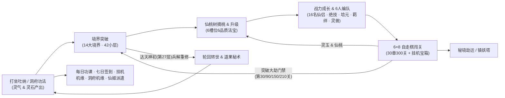
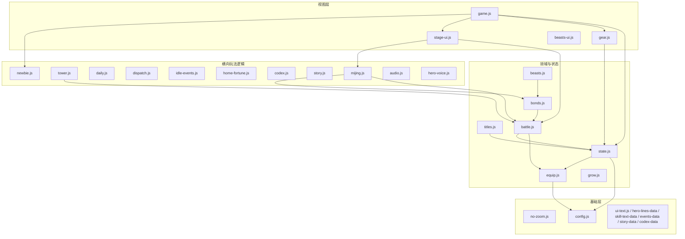

# 暗黑修仙（纯前端 H5）架构设计文档

本目录收录了《暗黑修仙》仓库的完整架构设计文档。内容按仓库源码梳理，对应 GitHub 仓库 [CalDey/idle_game](https://github.com/CalDey/idle_game) 的 **main 分支提交 `851adfb`**（完整哈希 `851adfb669104be15dfdc4f5c9068b9b6f7f9816`，2026-11-15）。线上 GitHub Pages 为 [https://caldey.github.io/idle_game/](https://caldey.github.io/idle_game/)。

源码入口见 [`index.html`](../../index.html)、[`css/style.css`](../../css/style.css)、`js/*.js` 与 `tools/*.js`。文档旨在说明系统设计、模块边界、数据流转、数值公式与扩展方式。

> 初稿曾对照较旧的 `af27257`。此后 main 已接入秘境、图鉴、羁绊、签到/派遣、镇妖塔、灵兽、培元、剧情、音频等系统，本套文档已按 `851adfb` 修订。

---

## 1. 文档索引

| 序号 | 文档名称 | 核心内容概述 |
| :--- | :--- | :--- |
| 01 | [README.md](./README.md) | 文档索引与项目总览：技术栈、目录结构、核心玩法闭环、脚本加载顺序与模块关系图 |
| 02 | [modules.md](./modules.md) | `js/` 下全部模块的职责、对外接口、依赖关系与数据流 |
| 03 | [state-and-save.md](./state-and-save.md) | 游戏状态模型（存档结构版本仍为 `version: 3`）、`localStorage` 存档/读档、`v1 → v2 → v3` 迁移、离线收益、轮回保留策略及风险 |
| 04 | [game-loop-and-battle.md](./game-loop-and-battle.md) | 主循环（`requestAnimationFrame`）、境界突破、6×8 自走棋引擎、数值公式入口及时序图 |
| 05 | [assets-and-ui.md](./assets-and-ui.md) | 静态资源规范（立绘、头像、敌人、法宝、洞府、灵兽、字体）、五页签 UI、弹窗与移动端适配 |
| 06 | [testing-and-tools.md](./testing-and-tools.md) | `tools/` 下 18 个 `*.test.js` 与 3 个数值模拟脚本的用途与运行方式 |
| 07 | [roadmap-and-tech-debt.md](./roadmap-and-tech-debt.md) | 现存技术债、已修复项、重构建议与新系统接入方式 |

---

## 2. 项目总览

《暗黑修仙》是一款古风暗黑玄金视觉的**纯前端 H5 修仙放置 + 6×8 棋盘自走棋闯关游戏**，可直接托管于 GitHub Pages 或任意静态文件服务器，零后端依赖。

### 2.1 核心玩法闭环



1. **修行（`#tab-cultivate`）**：点击立绘打坐吐纳（`handleMeditationTap`）及每帧自动周天运转积累**灵气（`qi`）**，冲击从「搬血初」到「至尊后」共 **14 个大境界、42 个小阶段**（`REALM_STAGES`），收集 15 种称号（`TITLES`）。新档前 3 次突破保底成功。
2. **洞府与功法（`#tab-upgrades`）**：消耗**灵石（`stones`）**升级 6 座洞府灵建（`DONGFU_LIST`，提升灵石秒产；灵泉等级还可延长离线上限）与 6 部功法（`GONGFA_LIST`，提升灵气秒产）。洞府页另有仙姬派遣入口与洞府机缘标记。
3. **仙桃树与法宝（`#tab-gear`）**：突破至「搬血中」（`realmIndex >= 1`）解锁，获赠 30 枚仙桃（`grantPeachGift`）。消耗仙桃抽取 6 部位、6 品质法宝（`Equip.rollItem`）；地品及以上会写入专名（`item.name`），旧档无专名时回退旧显示名。灵玉用于将仙桃树升至最高 Lv25。
4. **自走棋闯关（`#tab-stage`）**：突破至「搬血后」（`realmIndex >= 2`）解锁。从 16 名角色中编组最多 6 人，在 **6 列 × 8 行**棋盘下半区布阵，挑战 6 大区域、30 章共 300 关。第 30 / 90 / 150 / 210 关构成第 9 / 18 / 27 / 36 层大境界天劫门禁（`TRIBULATION_GATES`）。同页还挂接秘境劫运、镇妖塔、羁绊条与主线剧情。
5. **轮回转世（`#tab-reincarnate`）**：达到「天神初」（`realmIndex >= 27`）后可兵解重修（`performReincarnation`），凝结**道果（`daoGuo`）**，装备按 50% 灵玉折算返还，用于升级 3 项永久道果秘术（`DAOGUO_TALENTS`）。图鉴、秘境次数、派遣、灵兽、培元、镇妖塔、功课、洞府机缘等按规则保留。
6. **横向系统（顶栏/弹窗，不占底部页签）**：每日功课与七日签到、挂机随机机缘、只读图鉴、仙姬培元、灵兽伴生、Web Audio 音乐/音效（默认关闭）。

---

## 3. 技术栈

- **运行环境**：现代浏览器（移动端 / 桌面端），零后端、零运行时第三方框架。仓库根目录**没有** `package.json`，测试用 Node.js 内置 `vm` / `assert` / `fs`，不依赖 jsdom。
- **前端实现**：
  - **HTML5**：单页骨架（`index.html`），顶部资源栏、5 个主功能页签、底部导航，以及日志/设置/队伍/秘境/图鉴/派遣/功课等若干模态弹窗。
  - **CSS3**：单文件 `css/style.css`（约 7287 行），CSS 变量构建古风暗黑视觉，结合 `100dvh`、`env(safe-area-inset-*)` 与媒体查询适配移动端。
  - **Vanilla JavaScript (ES6+)**：模块以 IIFE 封装，通过 `window.*` 暴露接口。`battle.js`、`bonds.js`、`mijing.js`、`daily.js`、`dispatch.js`、`tower.js`、`grow.js`、`beasts.js` 等额外兼容 `module.exports`，便于 Node 测试。
  - **HTML5 Canvas**：修行页立绘舞台的灵气粒子（`initQiMotes`）。
  - **Web Audio**：`js/audio.js` 实时合成吐纳 / 突破 / Boss 现身音效与古琴埙声 BGM，仓库内不含音频文件（见 `docs/AUDIO_SOURCES.md`）。
  - **Web Storage (`localStorage`)**：主存档 `xiuxian_idle_save_v1`、旧版迁移备份 `xiuxian_idle_save_v1_bak`、损坏存档备份 `xiuxian_idle_save_v1_corrupt`、立绘偏好 `xiuxian_portrait_focus`、音频开关 `xiuxian_audio`。
- **主循环**：`requestAnimationFrame(gameLoop)`（不再使用 200ms `setInterval`），用真实时间差结算资源，每 4 秒自动存档。

---

## 4. 仓库目录结构

```text
idle_game/
├── index.html                  # 单页入口：DOM 结构与 <script> 加载顺序
├── css/style.css               # 全局样式（主题、五页签、棋盘、弹窗、引导与响应式）
├── js/                         # 前端模块（按 index.html 脚本顺序加载，见第 5 节）
├── assets/
│   ├── hero_*_hd.jpg / hero_*_poster.jpg   # 角色主立绘与海报（现用图多为 1080×1920）
│   ├── battle/                 # 自走棋头像（avatars/）、区域背景、棋子框
│   ├── enemies/                # 18 种小怪 + 30 位 Boss + placeholder
│   ├── beasts/                 # 三只灵兽全身图与头像
│   ├── fonts/                  # 马善政字体子集（woff2）与 OFL.txt
│   ├── icons/                  # 导航、资源、功法、洞府、天赋、空槽、UI 图标
│   │   ├── gear/               # 6 部位 × 6 品质 = 36 张法宝图标（不再使用 icons/equip/）
│   │   └── tree/               # 6 阶仙桃树外观（含 @128 缩略图）
│   └── home/                   # 洞府底图 scene_base.webp 与建筑进阶补丁 p_*_{xuan,xian}.webp
├── tools/                      # Node 测试与数值模拟（18 个 *.test.js + sim / battle-sim / beast-sim）
└── docs/
    ├── AUDIO_SOURCES.md        # 音效/BGM 来源与许可
    └── architecture/           # 本套架构设计文档
```

说明：仓库里还保留少量历史立绘文件（如 `hero_cloak_hd.jpg`、`hero_saintess_hd.jpg`），当前 `GameConfig.HEROES` 已改指向 Dawn 放大后的 `*_dawn_*` / `*_v4b_*` / `*_hd.jpg` 路径。已不再使用 `assets/stage/`、`assets/hero_*@240.webp`、`*_cutout.webp` 与 `assets/stage/vfx/`。

---

## 5. 脚本加载顺序与模块关系

项目不使用打包工具，[`index.html`](../../index.html) 底部的 `<script>` 顺序即初始化次序（当前缓存版本号以 HTML 为准）：

1. `js/no-zoom.js` — 移动端防缩放（无导出）
2. `js/config.js` — `window.GameConfig` / `window.CONFIG`
3. `js/beasts.js` — `window.Beasts`（逻辑，需在战斗加成合并前就绪）
4. `js/ui-text.js` — `window.UIText`
5. `js/equip.js` — `window.Equip`
6. `js/state.js` — `window.GameState`
7. `js/titles.js` — `window.Titles` / `window.TitlesUI`
8. `js/grow.js` — `window.Grow` / `window.GrowUI`
9. `js/battle.js` — `window.Battle`
10. `js/bonds.js` — `window.Bonds`（羁绊；在 battle 之后、mijing 之前）
11. `js/mijing.js` — `window.Mijing`
12. `js/tower.js` — `window.Tower` / `window.TowerUI`
13. `js/gear.js` — `window.GearUI`
14. `js/stage-ui.js` — `window.StageUI`
15. `js/story-data.js` — `window.StoryData`
16. `js/story.js` — `window.Story`
17. `js/audio.js` — `window.GameAudio`
18. `js/newbie.js` — `window.Newbie`
19. `js/game.js` — 主控制器（`init` + `gameLoop`）
20. `js/events-data.js` — `window.GameEventsData`
21. `js/idle-events.js` — `window.IdleEvents`
22. `js/daily.js` — `window.Daily` / `window.DailyUI`
23. `js/home-fortune.js` — `window.HomeFortune` / `window.HomeFortuneUI`
24. `js/codex-data.js` — `window.CodexData`
25. `js/codex.js` — `window.Codex`
26. `js/hero-lines-data.js` — `window.HeroLinesData`
27. `js/hero-voice.js` — `window.HeroVoice`
28. `js/skill-text-data.js` — `window.SkillTextData`
29. `js/dispatch.js` — `window.Dispatch`（及派遣 UI）
30. `js/beasts-ui.js` — `window.BeastsUI`

`game.js` 在 `init()` 中初始化 TitlesUI / GearUI / StageUI / Newbie；Daily、Dispatch、Tower、Grow、Codex、IdleEvents、HomeFortune、Audio、HeroVoice、BeastsUI 等在各自文件里监听 `DOMContentLoaded` 自行挂载。

### 5.1 模块分层关系（示意图）



更细的接口与数据流见 [modules.md](./modules.md)。
