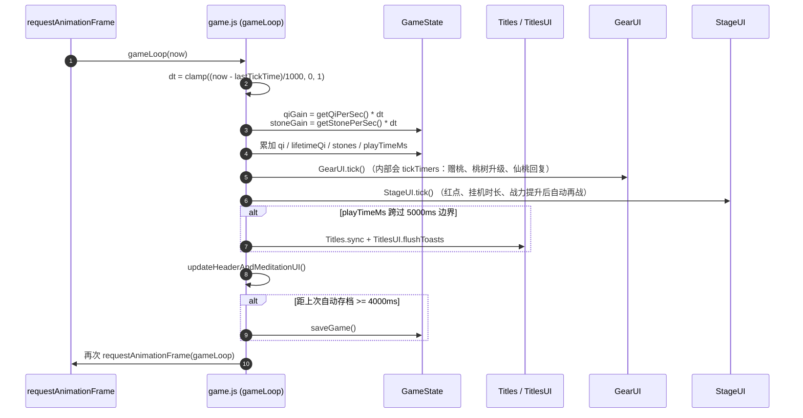
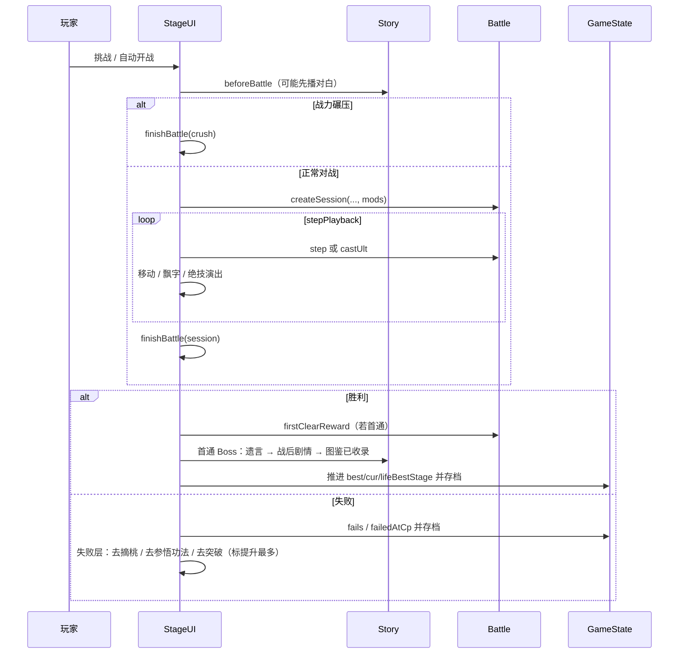
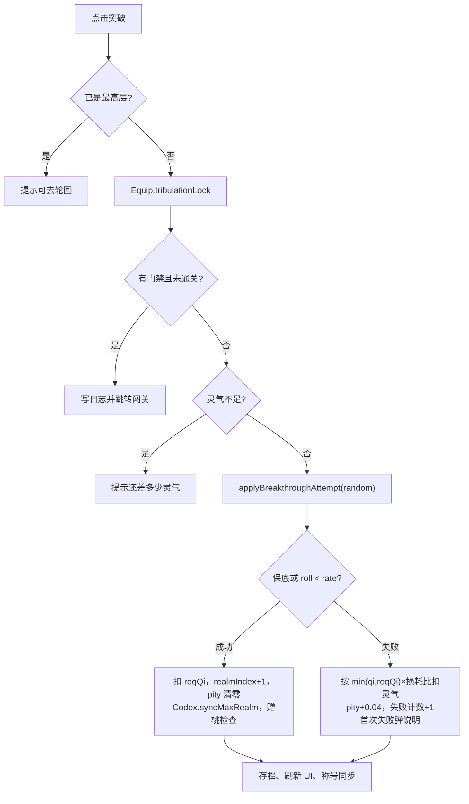

# 主循环、战斗流程、数值计算入口与事件时序

本文档基于 [js/game.js](../../js/game.js)、[js/state.js](../../js/state.js)、[js/equip.js](../../js/equip.js)、[js/battle.js](../../js/battle.js)、[js/gear.js](../../js/gear.js) 与 [js/stage-ui.js](../../js/stage-ui.js)，对照提交 **`851adfb`**。

---

## 1. 应用启动与主循环

### 1.1 启动引导（`init`，约 L1596–L1848）

`DOMContentLoaded`（若文档已就绪则立即）调用 `init()`：

1. `cacheElements()`、`restorePortraitFocus()`、`initTabs()`、`initHomeStageResize()`、`initHeroStage()`、`initQiMotes()`。
2. `GameState.loadGame()`：迁移、离线结算、`grantPeachGift`，并 `ensure` 功课/培元/塔/洞府机缘。
3. 首次渲染：立绘、角色列表、洞府/功法、轮回、顶栏与打坐面板。
4. 若有离线报告则 `showOfflineModal()`。
5. 绑定打坐、突破、洞府升级、日志/设置/角色、存档与重置等事件；监听 `beforeunload` 与 `visibilitychange`（切回走 `resumeFromBackground`）。
6. `TitlesUI.init()`、`GearUI.init({ log, onChange })`、`StageUI.init({ log, onChange, switchTab })`、`Newbie.init({ switchTab, log })`。
7. `lastTickTime = performance.now()` 后启动 `requestAnimationFrame(gameLoop)`。

Daily / Dispatch / Tower / Grow / Codex / IdleEvents / HomeFortune / Audio / HeroVoice / BeastsUI 在各自模块的 `DOMContentLoaded` 中自行 `init`。

### 1.2 主循环（`gameLoop`，约 L1567–L1594）

**不再使用 200ms `setInterval`。** 循环由 `requestAnimationFrame` 驱动，用真实时间差结算，并把单帧 `dt` 夹在 `[0, 1]` 秒，避免后台回前台时一帧把资源加爆（后台收益改由离线结算补）。

---

## 2. 6×8 自走棋战斗流程

逻辑层（`Battle.createSession`）与表现层（`StageUI`）解耦。会话使用确定性 PRNG `mulberry32(seed)`，`session.step({ autoUlt })` 产生 `move` / `attack` / `ult` / `skip_atk` / `die` 等事件；UI 负责位移、飘字与绝技演出。

开战前可被 `Story.beforeBattle` 拦一层（章首/战前对白）。秘境与镇妖塔复用同一套内核，额外传入 `mods`。

### 2.1 战前准备与碾压快通

点击挑战或自动开战时：

1. `Battle.canStartBattle(state)` 校验队伍 1–6 人。
2. 非 Boss、且为当前可打关、且我方战力达到敌方推荐战力 3 倍时，可直接 `finishBattle({ win: true, crush: true })` 秒过（具体条件以 `stage-ui.js` 为准）。
3. 否则 `createSession(state, enemy, seed, mods)`（`mods` 含羁绊/灵兽，秘境再叠加劫运），挂载棋子后进入回放。

推荐战力不再只展示 `enemyFor().cp`，而是与 `winRate` / 失败提示共用模拟（目标胜率默认 60%，即「大概率胜」）。

卡 Boss 且战力已超过推荐时，`StageUI.tick` 可自动再战一次；离线结算窗也可跳转「可挑战」。

### 2.2 单步状态机（概要）

`createSession` 内最多 `MAX_ROUNDS = 24` 回合，超时判负：

1. 行动队列：第 1 回合随机先手，之后按速度加扰动排序。
2. `autoUlt` 时优先释放满怒我方绝技。
3. 敌方 Boss 满怒放群体大招（主目标约 1.2× + 邻格溅射）。
4. 索敌：切比雪夫 → 曼哈顿 → 剩余生命。
5. 相邻则普攻（可被霜华类绝技 `skipNextAtk` 跳过）；怒气攻击 +22、受击 +14；满怒不屈可在首次致死时留 1 血以便放绝技。
6. 不相邻则八方向走一格。

默认站位：前排 3 人在 **第 5 行 `r=4`**，后排 3 人在 **第 7 行 `r=6`**（列多为 1/2/4）。我方活动范围仍是 `r ∈ [4..7]`。

### 2.3 绝技类型（`castUlt`）

以 `GameConfig.HERO_SKILLS` 为准（`851adfb`）：

| kind | 代表角色 | 要点 |
| :--- | :--- | :--- |
| `single` | 蓝旖（`lanyi`，**2.2× 单体**）、紫绫、晴岚、幽冥（可自吸） | 单体爆发，不溅射 |
| `splash_lifesteal` | 魔灵光（`cloak`） | 主伤+溅射后按主伤吸血 |
| `damage_heal_allies` | 圣王女、绛华、晴葵、月誓、霜宸 | 伤害后全队按最大生命比例回血 |
| `row` | 灼樱巫女、红莲、焚霄 | 主目标所在横排群攻 |
| `splash_freeze` | 霜华 | 主伤+溅射，主目标跳过下一次普攻 |
| `damage_buff_ally` | 甜心、墨兰 | 伤害后给当前最高攻友军挂短暂攻益 |

施放时队伍卡/棋盘可展示绝技说明，并飘出 `SkillTextData` 里的施放台词。

### 2.4 战斗时序（简图）

`winRateLabel(rate)` 现返回：`必胜` / `大概率胜` / `五五开` / `凶险` / `不敌`。

---

## 3. 核心数值公式（务必以源码为准）

旧文档中的若干公式已过时。以下按 `851adfb` 重写。

### 3.1 修仙产率与突破（`js/state.js`）

| 数值项 | 入口 | 当前公式 |
| :--- | :--- | :--- |
| 当前境界 | `getCurrentStage()` | 直接返回 `REALM_STAGES[realmIndex]`（生成表时已乘 `LATE_REALM_QI_MULT`） |
| 道果灵气倍率 | `getDaoGuoQiMultiplier()` | `(1 + totalDaoGuo × 0.25) × (1 + lv_先天道体 × 0.5)` |
| 道果灵石倍率 | `getDaoGuoStoneMultiplier()` | `(1 + totalDaoGuo × 0.20) × (1 + lv_天道眷顾 × 0.5)` |
| 每秒灵气 | `getQiPerSec()` L279 | 基础吐纳 **1/秒** + Σ(功法 `baseQiPerSec × lv`)，再乘：境界 `multiplier`、道果灵气倍率、`(1 + 装备 qi 副词条)`、`(1 + 0.02 × floor(best/10))`、`Titles.qiFactor`、`(1 + 0.01 × floor(聚灵石等级/10))`。**功法不再另加「每 10 级 +25%」项。** |
| 每秒灵石 | `getStonePerSec()` L303 | 基础 **0.5/秒** + Σ(洞府 `baseStonePerSec × lv`)，再乘：`multiplier^0.65`、道果灵石倍率、`(1 + stone 副词条)`、`(1 + 0.02 × 章节数)`、`Titles.factor(..., 'stone')`。**不再使用 `1 + realmIndex×0.08`，也没有洞府「每 10 级 +20%」。** |
| 点击灵气 | `getTapQiGain()` L500 | `max(2, round((3 + getQiPerSec()×0.35) × Titles.factor(..., 'tap') × 10) / 10)` |
| 破境成功率 | `getBreakthroughSuccessRate()` L565 | `min(0.98, stage.successRate + pityBonus + min(0.30, lv_不灭道心×0.03) + Titles.addend(..., 'break'))` |
| 可凝结道果 | `getPendingDaoGuo()` L574 | `realmIndex < 27` 为 0；否则 `max(2, floor(1.22^(realm-27)×2) + max(0, floor(log10(max(1, qi/1e6)))) + floor(chapter/5))`，其中 `chapter = floor(max(best, lifeBestStage)/10)` |
| 挂机收益 | `applyIdleStageRewards(sec)` L364 | `hours = sec/3600`；桃 `floor((1 + floor(best/50)) × hours)`，灵玉 `floor((6 + 0.4×best) × hours)`。桃只补到储存上限，已溢出不裁。`best==0` 不发 |
| 离线上限 | `getOfflineCapSeconds()` L534 | `min(15×3600, 12×3600 + floor(灵泉等级/20)×1800)` |

新手保底：`breakAttempts < 3` 时 `applyBreakthroughAttempt` 必定成功。失败损耗为 `floor(min(qi, reqQi) × failureLossRatio)`（按所需灵气封顶，而不是按当前全部灵气）。

### 3.2 装备、属性与战斗（`js/equip.js` / `js/battle.js`）

| 数值项 | 入口 | 当前公式 |
| :--- | :--- | :--- |
| 装备主属性 | `rollItem` | `round(slot.base × slot.growth^(lv-1) × quality.mult)` |
| 分解灵玉 | `decomposeValue` + `Titles.jadeValue` | 基础分解再乘称号 `jade` 倍率，至少 1 |
| 人物四维 | `attributes(state)` L200 | 设 `mult = stage.multiplier`，`allAttr = 1 + totalDaoGuo×0.05`： `atk = (10×mult + 兵器 + 玉佩) × (1 + atkPct + 功法总等级×0.005) × allAttr` `hp = (120×mult + 道冠 + 护腰) × (1 + hpPct + 洞府总等级×0.005) × allAttr` `def = (5×mult + 法袍) × (1 + defPct) × allAttr` `spd = 100 + 2×realmIndex + 云履主属性 + spd 副词条` `crit = min(0.6, 0.05 + crit 副词条)`，`critDmg = 1.5 + critDmg 副词条` **已不再使用 `(12+4r)×1.07^r` 那套基数。** |
| 综合战力 | `combatPower` | `(10×atk + hp + 8×def + 2×spd) × (1 + crit×(critDmg-1)) × Titles.factor(..., 'cp')`（实现上先算 `combatPowerFrom`，再乘称号） |
| 关卡基准战力 | `enemyFor` | `cp = 600 × 1.0223^(n-1) × (Boss ? 1.5 : 1)`；`atk/hp/def = cp × {0.04, 0.40, 0.0165}` |
| 命中伤害 | `rollHit`（battle.js） | 有效防御按双方 `share` 缩放后，`atk²/(atk+effDef)` 再乘节奏、走位、攻益、暴击与 `Uniform(0.95,1.05)`。UI 显示再乘 `DISPLAY_MULT = 10` |

培元、羁绊、灵兽、秘境劫运在构造战斗单位或 `createSession` 的 `mods` 里叠加，不直接改写 `Equip.attributes` 的全身总属性（培元是按人加成）。

---

## 4. 关键交互：突破与摘桃

### 4.1 境界突破（`attemptBreakthrough`，约 L303–L365）

### 4.2 摘桃与对比

流程仍是：有 `pending` 则先打开对比 → 否则扣桃并 `Equip.rollItem` → 空槽直接穿 → 满足自动分解则分解 → 否则进 `#compare-modal`。对比弹窗会标注当前装备/新获得，以及战力差绿↑红↓。替换成功后可触发 `StageUI` 的战力提升自动再战。
