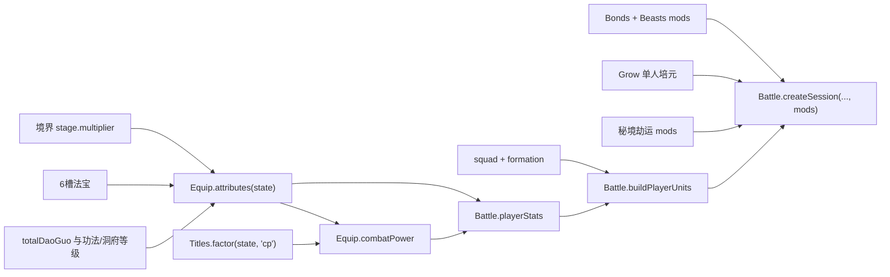

# `js/` 核心模块职责、接口与数据流说明

本文档说明 `js/` 目录下全部 JavaScript 模块的职责边界、对外接口、依赖关系及核心数据流。行数与接口以本提交（节奏 v2 / 文案定稿接入后的 main）为准。

当前共 **33 个脚本**（见 [README.md 第 5 节](./README.md) 的加载顺序），不再是早期的 9 个文件。

---

## 1. 模块一览

### 1.1 基础与配置

| 文件 | 行数 | 全局导出 | 职责简述 |
| :--- | :---: | :--- | :--- |
| [js/no-zoom.js](../../js/no-zoom.js) | 50 | 无（纯副作用） | 拦截手势缩放、多指缩放、双击放大与 `Ctrl+滚轮` |
| [js/config.js](../../js/config.js) | 1464 | `GameConfig` / `CONFIG` | 境界、装备、桃树、功法、洞府、道果、称号、战斗常量、`MIJING` 测力常数、16 名角色与绝技、法宝专名池 `GEAR_UNIQUE_NAMES`、章节短名、`ELITE_MULT` / `EARLY_RAMP`、节奏 v2 境界与洞府参数等 |
| [js/ui-text.js](../../js/ui-text.js) | 196 | `UIText` | 突破 / 渡劫 / 离线 / 仙桃树 / 洞府 / 轮回等界面文案 |
| [js/events-data.js](../../js/events-data.js) | 918 | `GameEventsData` | 24 条挂机/洞府机缘事件文案（`pool: idle / home`） |
| [js/codex-data.js](../../js/codex-data.js) | 804 | `CodexData` | 图鉴条目与 Boss/小怪文案、开场台词 |
| [js/story-data.js](../../js/story-data.js) | 1651 | `StoryData` | 第 1–30 章主线对白与 30 个 Boss 遗言 |
| [js/hero-lines-data.js](../../js/hero-lines-data.js) | 122 | `HeroLinesData` | 角色日常台词（点击/突破/闲置/出战/阵亡） |
| [js/skill-text-data.js](../../js/skill-text-data.js) | 99 | `SkillTextData` | 绝技说明与施放台词（只做展示，数值仍以 config 为准） |
| [js/tribulation-data.js](../../js/tribulation-data.js) | 60 | `TribulationData` | 渡劫演出文案 |

### 1.2 核心领域与状态

| 文件 | 行数 | 全局导出 | 职责简述 |
| :--- | :---: | :--- | :--- |
| [js/equip.js](../../js/equip.js) | 284 | `Equip` | 装备生成（含专名）、属性/战力、天劫锁；不读写存档 |
| [js/state.js](../../js/state.js) | 1521 | `GameState` | 状态树、产率、存档迁移、离线结算、轮回、小队、新手保底突破；节奏 v2 老档一次性补偿与已有道果旧倍率保留 |
| [js/titles.js](../../js/titles.js) | 391 | `Titles` / `TitlesUI` | 15 个称号的条件、乘区与铭牌/弹窗 |
| [js/battle.js](../../js/battle.js) | 2103 | `Battle`（兼 `module.exports`） | 6×8 确定性自走棋、绝技、胜率与推荐战力模拟 |
| [js/bonds.js](../../js/bonds.js) | 248 | `Bonds` | 仙缘标签与 6 条羁绊（含 `loreName` / `flavor`；档位为 params_v2 ×0.6），不写存档 |
| [js/beasts.js](../../js/beasts.js) | 227 | `Beasts` | 三只灵兽解锁/喂养/加成，经 `Bonds.modsForState` 并入战斗 |
| [js/grow.js](../../js/grow.js) | 370 | `Grow` / `GrowUI` | 仙姬培元（按人升级，加成自身攻防血） |

### 1.3 横向玩法

| 文件 | 行数 | 全局导出 | 职责简述 |
| :--- | :---: | :--- | :--- |
| [js/mijing.js](../../js/mijing.js) | 778 | `Mijing` | 秘境劫运：每日 2 次、8 波连战、每 2 波三选一；测力可缓存 |
| [js/tower.js](../../js/tower.js) | 556 | `Tower` / `TowerUI` | 镇妖塔：独立爬塔，每日 3 次失败，首通奖励 |
| [js/daily.js](../../js/daily.js) | 575 | `Daily` / `DailyUI` | 每日功课活跃度宝箱与七日累计签到 |
| [js/dispatch.js](../../js/dispatch.js) | 851 | `Dispatch` | 仙姬派遣：每日 4 条悬赏，真实时间计时 |
| [js/idle-events.js](../../js/idle-events.js) | 476 | `IdleEvents` | 挂机随机机缘（10–20 分钟冷却，顶栏入口） |
| [js/home-fortune.js](../../js/home-fortune.js) | 486 | `HomeFortune` / `HomeFortuneUI` | 洞府挂机偶发机缘，复用事件池 |
| [js/codex.js](../../js/codex.js) | 764 | `Codex` | 只读图鉴；存档字段 `state.codex = { v, maxRealm }` |
| [js/story.js](../../js/story.js) | 506 | `Story` | 主线剧情弹窗、往事回溯（`RECALL_TEXT` 副标题/按钮/30 章简介，「果子」按第 26 章通关揭示）、1-1 战败旁白 `stage1_1_fail`；进度记在 `state.storySeen` |
| [js/path.js](../../js/path.js) | 553 | `Path` | 本命道途（剑/体/符）；显示名与「改道」文案来自世界观定稿，路径/节点 id 不变；节点 per 为 v2 的 6 折（含符道经济） |
| [js/tribulation.js](../../js/tribulation.js) | 299 | `Tribulation` | 大境界渡劫演出（纯 CSS/DOM） |
| [js/newbie.js](../../js/newbie.js) | 2037 | `Newbie` | 新手引导、当前目标条、解锁卡、Esc/遮罩关弹窗、角色卡简介与选中台词 |
| [js/audio.js](../../js/audio.js) | 544 | `GameAudio` | Web Audio 合成音效/BGM，开关默认关，需手势后才建上下文 |
| [js/hero-voice.js](../../js/hero-voice.js) | 145 | `HeroVoice` | 立绘/棋盘台词气泡（限频、不阻塞） |

### 1.4 视图与主控

| 文件 | 行数 | 全局导出 | 职责简述 |
| :--- | :---: | :--- | :--- |
| [js/gear.js](../../js/gear.js) | 520 | `GearUI` | 法宝页：摘桃、对比、分解、桃树升级；周期调用 `GameState.tickTimers` |
| [js/stage-ui.js](../../js/stage-ui.js) | 3544 | `StageUI` | 闯关页：棋盘、布阵、回放、秘境/塔入口、羁绊条、失败跳转、挂机宝箱 |
| [js/game.js](../../js/game.js) | 2101 | `portraitHeroList` / `roleCardClassName` | 主循环、修行/洞府/轮回/通用弹窗 |
| [js/beasts-ui.js](../../js/beasts-ui.js) | 226 | `BeastsUI` | 灵兽伴生界面 |

---

## 2. 核心模块详解

### 2.1 `js/no-zoom.js`

- 监听 `gesturestart/change/end`、多指 `touchmove`、间隔 ≤350ms 的 `touchend`（并在非表单元素上补一次 `click()`），以及按住 Ctrl 的 `wheel`，全部 `preventDefault`。
- 无全局导出。

### 2.2 `js/config.js`

只读静态数据源，挂在 `window.GameConfig`（别名 `window.CONFIG`）。主要导出：

| 键名 | 说明 |
| :--- | :--- |
| `MAJOR_REALMS` / `REALM_STAGES` / `LATE_REALM_QI_MULT` | 14 大境界展开为 42 小层。`LATE_REALM_QI_MULT` 在生成 `REALM_STAGES` 时已乘入 `reqQi`，`getCurrentStage()` 直接取表，不再运行时另乘 |
| `GONGFA_LIST` / `DONGFU_LIST` / `DAOGUO_TALENTS` | 6 功法、6 洞府、3 项道果秘术 |
| `HOME_TIERS` / `HOME_SCENE` / `homeBuildingTier` / `homeBgTier` | 洞府视觉阶与岛屿坐标 |
| `OFFLINE_CAP_SECONDS` | 基础上限 `12 * 3600`；实际上限还受灵泉等级影响，封顶 15 小时（见 state） |
| `REINCARNATION_MIN_STAGE` | `27`（天神初） |
| `ENABLE_STAGE_GATES` / `TRIBULATION_GATES` | 大劫门禁：`realmIndex` 8/17/26/35 分别要求通关 30/90/150/210 |
| `EQUIP_SLOTS` / `QUALITIES` / `SUBSTATS` / `GEAR_UNIQUE_NAMES` | 6 槽、6 品质、副词条；地/天/仙品专名池（72 个） |
| `TREE_*` / `treeStage` / `treeUpgradeCost` / `peachCap` | 仙桃树 Lv1–25 |
| `BATTLE` | 棋盘战斗常量（`BASE_CP: 600`、`GROWTH: 1.0223`、`BOSS_MULT: 1.5`、`SPLIT`、`MAX_ROUNDS: 24`、`REGIONS`、`BOSSES`、`CHAPTERS` 短名、`UNLOCK_REALM: 2`） |
| `MIJING` | 测力常数：`PROBE_SIMS: 12`、`PROBE_ITERS: 7`、`ANCHOR_FLOOR_MULT: 0.85` |
| `PEACH` | 仙桃再生；解锁境界为搬血中（`UNLOCK_REALM: 1`） |
| `TITLES` / `TITLE_COLLECTION_QI` | 15 个称号；每枚已收集 `+0.5%` 灵气。称号 `stat` 为 `qi` / `tap` / `break` / `peach` / `jade` / `cp` |
| `HERO_SKILLS` / `HEROES` | 16 名角色绝技与元数据（头像改走 `assets/battle/avatars/`，立绘为 `hero_*_hd.jpg` 等） |
| `formatNumber` / `formatDuration` | 国风大数与时长格式化 |

### 2.3 `js/equip.js`

纯逻辑，不操作 DOM。`window.Equip` 主要接口：

- `emptyEquip()` / `defaultStage(now)` / `defaultV2Fields(now)`：空装备、闯关子状态、V2 字段默认集（含 `lingyu`、`tree`、`equip`、`pending`、`pity`、`autoDecomp`、`stage`、`lifeBestStage`、`seq`）。
- `qualityWeights(treeLevel)` / `rollItem(state)`：品质权重插值与抽装。地品保底 `pity.di >= 50`（`q>=3`），天品保底 `pity.tian >= 200`（`q>=4`）。地品及以上会写入 `item.name`（专名），**不额外消耗随机数**；`itemName(item)` 优先专名，旧档回退「品阶+默认名」；`itemFlavor(item)` 只认池内专名。
- `attributes(state)` / `combatPower(state)` / `powerWithSwap(state, item)`：人物四维与战力（公式见 [game-loop-and-battle.md](./game-loop-and-battle.md)）。培元加成在 Grow 侧注入战斗单位，不改写这里的全身总属性口径（以源码为准）。
- `tribulationLock(state)`：未满足天劫关卡门禁时返回 `{ chapter, stage, boss }`。

依赖 `GameConfig`；分解灵玉可经 `Titles.jadeValue` 加成。

### 2.4 `js/state.js`

维护单例 `state`，导出 `window.GameState`。除产率与存档外，还包含新手保底与前后台补算：

| 接口 | 说明 |
| :--- | :--- |
| `state` | 只读访问器，当前状态树 |
| `MAX_SQUAD_SIZE` | `6` |
| `getCurrentStage()` | 返回 `REALM_STAGES[realmIndex]`（`reqQi` 已含后期倍率） |
| `getDaoGuoQiMultiplier()` / `getDaoGuoStoneMultiplier()` | 道果总量加成 × 对应秘术等级加成 |
| `getQiPerSec()` / `getStonePerSec()` / `getTapQiGain()` | 产率与点击收益 |
| `getBreakthroughSuccessRate()` | 成功率上限 `0.98`；称号加法项 kind 为 `'break'` |
| `GUARANTEED_BREAKS` / `isBreakGuaranteed()` / `applyBreakthroughAttempt(roll)` | 新档前 3 次必成；失败损耗按 `min(qi, reqQi) * failureLossRatio` |
| `getPendingDaoGuo()` / `performReincarnation()` | 天神初起可凝结道果并转世 |
| `getSquad()` / `setSquad()` / `unlockHero()` | 1–6 人编队，同步 `state.squad` 与 `state.stage.squad` |
| `saveGame()` / `loadGame()` / `resetGame()` | 存档生命周期；坏档写入 `SAVE_CORRUPT_KEY` 后再重置 |
| `settleOffline` / `resumeFromBackground` / `settleAwayProgress` / `applyOfflineWindow` | 读档离线结算与回前台补算（阈值 3 秒，弹窗展示门槛 60 秒） |
| `tickTimers(now)` | 赠桃、桃树升级完成、仙桃自然回复（由 `GearUI.tick` 调用） |
| `grantPeachGift()` / `applyIdleStageRewards(seconds)` | 搬血中赠 30 桃；挂机桃/灵玉（桃只补到上限） |
| `defaultGuide` / `normalizeGuide` / `normalizeStorySeen` 等 | 引导、解锁卡、剧情已读字段的规范化 |

`createDefaultState()` 会预置 `daily`、`mijing`、`guide`、`breakAttempts`、`unlockSeen`、`storySeen`。`dispatch` / `beasts` / `grow` / `tower` / `homeFortune` / `codex` / `idleEvents` 等由各模块 `ensure` / `normalize` 在读档或初始化时补齐。`mergeSave` 会合并这些子系统，并对 9 名后加免费角色做补发。

### 2.5 `js/titles.js`

两个 IIFE：`Titles`（条件与乘区）与 `TitlesUI`（铭牌、Toast、`#title-modal`）。

- `ensure` / `noteLogin` / `noteTap` / `sync` / `consumeFresh` / `wear`。
- `factor(state, stat)`、`addend(state, stat)`、`qiFactor`（收集每个 `+0.5%` + 佩戴 `qi`）、`jadeValue`、`peachIntervalMs`。
- 解锁条件示例：累计失败 3 次 →「屡败屡战」；单日点击 1000 →「点到手酸」；一次离线满 12 小时 →「闭关不出」（该称号的 `stat` 是 `qi +3%`，**不再**额外增加离线小时数）。

### 2.6 `js/battle.js`

零 DOM 依赖。棋盘 6×8，我方默认站位为前排 `r=4`、后排 `r=6`（各 3 格）。主要接口：

- 编队：`isHeroUnlocked` / `sanitizeSquadIds` / `getSquadIds` / `setSquad` / `ensureFormation` / `canStartBattle`。
- `enemyFor(stageNum)`：返回关卡信息，数值字段为 `cp`（不是旧文档里的 `recCp`），并带 `chapterName` / `stageName` 供主线顶栏与 Boss 标题显示；秘境顶栏仍用大地域名。
- `playerStats` / `buildPlayerUnits` / `buildEnemyUnits`：我方属性按上阵人数均分，并乘走位补偿 `playerAtkComp = 1.09`。
- `createSession(state, enemy, seed, mods)`：可注入羁绊/劫运/灵兽 `mods`。会话提供 `step({autoUlt})`、`castUlt`、`runToEnd`。
- `simulate` / `winRate` / `winRateLabel`：`winRateLabel` 现返回纯文案字符串：`必胜` / `大概率胜` / `五五开` / `凶险` / `不敌`（UI 侧会写成「胜算：…」）。
- 推荐战力改为与胜率同一套模拟（目标胜率默认 60%，即「大概率胜」），避免和失败提示互相矛盾。
- 仍保留 `FALLBACK_HERO_SKILLS` 作为缺配置兜底（与 `GameConfig.HERO_SKILLS` 双份维护，见技术债）。

清冷剑仙 `lanyi` 绝技当前为 `kind: 'single'`、`mainMult: 2.2`（已不是旧文档中的 `splash` 1.6×）。其余角色种类仍覆盖 `splash_lifesteal` / `damage_heal_allies` / `row` / `splash_freeze` / `damage_buff_ally` / `single`。

### 2.7 羁绊、灵兽与培元

- **Bonds**：16 名角色各 1–2 个仙缘标签；6 条羁绊在 2 / 3 人时激活两档。短名保留，另有 `loreName` / `flavor`。战斗加成经 `createSession(..., mods)` 的 `heroMods` 注入，不写存档。
- **Beasts**：幽冥玄狐（第 30 关）、霜纹守山麟（第 90 关）、赤焰金乌（第 150 关）。同时只伴生一只，灵玉+仙桃喂养至 Lv10。全队攻击 `+0.4%/级`，同系角色另有小加成。存档 `state.beasts`，轮回保留。
- **Grow**：按人消耗灵玉升级，上限随境界提高（硬顶 13）。生效等级为 `min(已学, 当前境界上限)`，超额不退灵玉、突破后自动恢复。轮回保留已学等级。

### 2.8 秘境、镇妖塔、功课、派遣与机缘

- **Mijing**：第 10 关解锁，每日 2 次、8 波；第 4 波精英、第 8 波 Boss。开局用 `measureStrength` 二分测力（`12` 次模拟 × `7` 轮，缓存未命中时最多约 84 次战斗模拟），同签名结果写入内存缓存。轮回保留当日次数与进行中的一局。
- **Tower**：第 20 关解锁，独立爬塔，每日 3 次失败（胜利不扣次），只发首通奖励。`state.tower` 轮回深拷贝保留。
- **Daily**：把闯关、秘境、机缘、突破、洞府/功法、摘桃等打包成每日功课，活跃度宝箱 + 累计七日签到（漏签不重置周期进度的累计天数）。`createDefaultState()` 已预置 `daily`。
- **Dispatch**：每日 4 条悬赏，派未上阵仙姬，时长 2–8 小时（不超过离线上限），仙缘标签每人 +25%。奖励仅灵石/灵玉/仙桃。轮回保留进行中的派遣与当日榜。
- **IdleEvents / HomeFortune**：挂机机缘 10–20 分钟冷却，顶栏入口非强制弹窗；洞府机缘按在线 20–40 分钟刷出，每日有上限，离线按封顶条数补积。文案复用同一事件池。

### 2.9 图鉴、剧情、新手、音频

- **Codex**：只读图鉴（境界/地域/势力/纪元/角色/妖魔）。解锁由存档推导；`state.codex.maxRealm` 用于转世后不重新上锁。`performReincarnation` 会深拷 `state.codex` 并调用 `Codex.syncMaxRealm`。图鉴 `quote` 仍作 Boss 开场白，不用遗言覆盖。
- **Story**：章首 / Boss 战前战后对白 + 首通遗言 +「图鉴已收录」。可跳过；`state.storySeen` 记录，旧档按已通关进度补记。
- **Newbie**：前三步高亮引导、常驻深底金字目标条、通用解锁卡、锁定内容剪影与「还差 X 重」、弹窗 Esc/点遮罩关闭、角色卡品阶与简介、选中台词。
- **GameAudio**：设置里两个开关默认关；手势后才创建 `AudioContext`；页面隐藏时暂停。

### 2.10 `js/gear.js` / `js/stage-ui.js` / `js/game.js`

- **GearUI**：`init({ log, onChange })`、`render()`、`tick()`。`tick()` 会调用 `GameState.tickTimers(Date.now())`，因此桃树计时依赖法宝模块被周期唤醒（主循环每帧也会调用 `GearUI.tick()`）。
- **StageUI**：`init({ log, onChange, switchTab })`、`render()`、`tick()`、`onShow` / `onHide`、开战/跳过/碾压秒过、队伍弹窗、自动再战、失败后「去摘桃 / 去参悟功法 / 去突破」并标出提升最多。文件已超过 3200 行，同时承担秘境/塔入口 UI、羁绊展示与剧情拦截。
- **game.js**：`init()` 里 `loadGame()`、渲染洞府/轮回、绑定打坐与突破，再 `TitlesUI` / `GearUI` / `StageUI` / `Newbie.init`，最后 `requestAnimationFrame(gameLoop)`。对外仍导出 `portraitHeroList`、`roleCardClassName`。回前台走 `GameState.resumeFromBackground`。

---

## 3. 核心跨模块数据流

### 3.1 UI 钩子

`game.js` 向 GearUI / StageUI 注入 `{ log, onChange, switchTab }`，避免 UI 模块反向依赖主控内部函数。称号、每日功课、派遣、图鉴、灵兽、音频等多为自初始化，再通过 `GameState.state` 与 `Daily.hook` 等与领域层交互。

### 3.2 战力与战斗加成聚合

具体公式见 [game-loop-and-battle.md](./game-loop-and-battle.md)。
