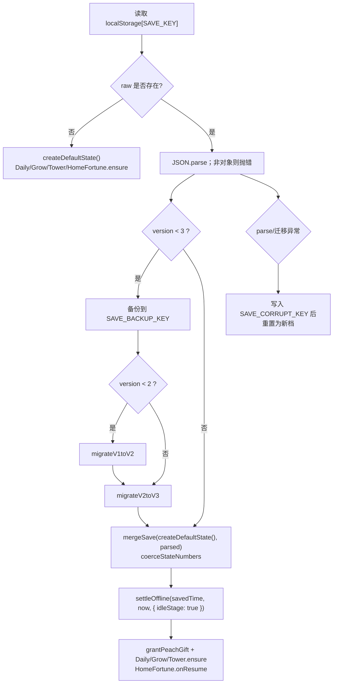

# 游戏状态模型、存档/读档、离线收益与版本迁移

本文档基于 [js/state.js](../../js/state.js)、[js/equip.js](../../js/equip.js) 及各玩法模块的 `ensure` / `normalize`，说明运行时状态树（存档结构版本仍为 **`version: 3`**）、`localStorage` 机制、`v1 → v2 → v3` 迁移、离线结算、轮回保留策略与风险。对照提交 **`851adfb`**。

---

## 1. 游戏状态模型（`GameState.state`）

默认状态由 `createDefaultState()`（约 L189–L252）结合 `Equip.defaultV2Fields(now)` 生成，经 `window.GameState.state` 暴露。读档后再由 Daily / Grow / Tower / HomeFortune / Codex / Dispatch / Beasts / IdleEvents 等模块补齐缺省字段。

### 1.1 完整状态 Schema（Version 3 + 后续热更字段）

`state.version` **没有升到 4**。新系统一律走 `mergeSave` + 各模块 `normalize`，而不是新的存档大版本。

```javascript
{
  // === 1. 版本与角色编队 ===
  version: 3,
  heroId: 'lanyi',                 // 修行页主角立绘（默认清冷剑仙）
  squad: [ /* 1~6 个已解锁角色 ID，默认前 6 名 */ ],
  formation: {                     // 由 Battle.ensureFormation 维护：c∈[0..5], r∈[4..7]
    lanyi: { c: 2, r: 4 }
  },
  unlockedHeroes: [...],           // 可选：显式已解锁列表
  lockedHeroes: [...],             // 可选：显式锁定（补发时尊重）

  // === 2. 核心修仙资源与境界 ===
  realmIndex: 0,                   // 0=搬血初 ... 41=至尊后
  qi: 0,
  stones: 25,
  pityBonus: 0,                    // 破境失败 +0.04，上限 0.35，成功清零
  lingyu: 0,
  breakAttempts: 0,                // 累计突破次数；< 3 时新手保底必成

  // === 3. 功法与洞府 ===
  gongfa: { yinqijue: 1, taiqingjue: 0, zhuji_zhenjie: 0, jiuzhuan_jindan: 0, zixiao_yuanying: 0, taixu_huashen: 0 },
  dongfu: { julingshi: 1, lingquan: 0, yaoyuan: 0, lingmai: 0, dongtian_fudi: 0, xiantian_zuqiao: 0 },
  home: {
    maxTier: { /* 六座建筑历史最高视觉阶，转世不降 */ },
    bgMaxTier: 0
  },

  // === 4. 轮回与道果 ===
  reincarnationCount: 0,
  daoGuo: 0,
  totalDaoGuo: 0,                  // 参与产率与人物属性加成
  talents: { xiantian_daoti: 0, qiyun_jiashang: 0, pomo_daoxin: 0 },

  // === 5. 仙桃树与法宝（Equip.defaultV2Fields） ===
  tree: { lv: 1, peaches: 0, regenAt: 0, upEnd: 0, gifted: false },
  equip: { weapon: null, charm: null, crown: null, belt: null, robe: null, boots: null },
  pending: null,
  pity: { di: 0, tian: 0 },        // 50 保地、200 保天
  autoDecomp: { on: false, maxQ: 0, onlyWorse: true },
  seq: 0,

  // === 6. 闯关与挂机 ===
  stage: {
    cur: 1, best: 0, auto: true, idleAt: 0, speed: 2,
    fails: 0, wins: 0, losses: 0, streak: 0, maxStreak: 0,
    sweep: { date: '', used: 0 },  // 仍预留，尚未做扫荡玩法
    squad: [ /* 与顶层 squad 同步 */ ]
  },
  lifeBestStage: 0,

  // === 7. 统计、称号、引导 ===
  totalClicks: 0,
  lastSaveTime: 0,
  createdAt: 0,
  playTimeMs: 0,
  lifetimeQi: 0,
  failBreakthroughs: 0,
  peachesPicked: 0,
  decomposed: 0,
  flags: {
    ling: false, di: false, weapon: false, offlineCap: false,
    breakFailTipShown: false,      // 是否已显示首次破境失败说明
    squadTagHintShown: false       // 是否已提示「试试凑羁绊」
  },
  login: { last: '', streak: 0 },
  dayTaps: { date: '', count: 0 },
  titles: { owned: ['churu'], worn: 'churu', seen: ['churu'] },
  guide: { /* Newbie 引导进度，由 defaultGuide / normalizeGuide 规范化 */ },
  unlockSeen: {},                  // 已看过的解锁卡
  storySeen: {},                   // 已看过的主线/遗言、往事回溯与 1-1 战败旁白
  openingSeen: false,              // 开篇五屏；旧档读档视为已看

  // === 节奏 v2 补偿（不升 version，只加旗标，只对老档执行一次） ===
  pacingV2Compensated: true,       // 新档默认 true；缺字段的老档读档时补发后置 true
  pacingV2LegacyTotalDaoGuo: 0,    // 补偿时快照的已有道果；这些道果仍按旧倍率，新获得的用新系数
  pacingV2Notice: null,            // 一次性说明弹窗 { qi, stones, shown }
  refine: {},                      // 预留：装备淬炼 { slotId: lv }，本批只加字段
  exchange: { date: '', n: 0 },    // 预留：坊市灵石兑灵玉，本批只加字段

  // === 8. 子系统（默认预置或由模块 ensure） ===
  daily: { v: 1, date: '', points: 0, tasks: {}, chests: {}, checkin: { cycleDay: 0, last: '', total: 0 } },
  mijing: { date: '', used: 0, runs: 0, clears: 0, bestWave: 0, run: null },
  // 以下通常不在 createDefaultState 字面量里，由模块补齐：
  // grow:        { v: 1, lv: { [heroId]: number } }
  // tower:       { v: 1, best, claimed, date, fails }
  // dispatch:    当日悬赏与进行中的派遣
  // beasts:      { v, owned: { id: { lv } }, active }
  // codex:       { v, maxRealm }
  // idleEvents:  { v, pending, nextAt, recent, dgDay, count }
  // homeFortune: { v, date, spawned, pending, queued, recent, nextOnlineAt, onlineMs, lastSeen }
}
```

### 1.2 单件法宝对象（`Item`）

由 `Equip.rollItem(state)` 生成：

```javascript
{
  id: 42,                // ++state.seq
  s: 'weapon',           // 槽位
  q: 3,                  // 0=凡 ... 5=仙
  lv: 15,                // 与境界相关，夹在 1..99
  m: 38,                 // 主属性
  sub: [ ['crit', 0.025], ['atkPct', 0.085] ],
  name: '……'            // 可选：地/天/仙品专名；旧档没有此字段
}
```

---

## 2. 存档键名与保存时机

| 键名 | 定义位置 | 用途 |
| :--- | :--- | :--- |
| `xiuxian_idle_save_v1` | `state.js` `SAVE_KEY` | 主存档 JSON（键名仍带 `_v1`，内部 `state.version === 3`） |
| `xiuxian_idle_save_v1_bak` | `SAVE_BACKUP_KEY` | `version < 3` 时，迁移前备份原 JSON |
| `xiuxian_idle_save_v1_corrupt` | `SAVE_CORRUPT_KEY` | `loadGame` 解析/迁移异常时，先把坏档写到这里再重置 |
| `xiuxian_portrait_focus` | `game.js` `PORTRAIT_FOCUS_KEY` | 「赏玩立绘模式」开关（`'1'` / `'0'`） |
| `xiuxian_audio` | `audio.js` `PREF_KEY` | `{ music, sfx }`，默认均为 `false` |

### 2.1 `saveGame()` 触发时机

`saveGame()`（约 L744–L753）更新 `lastSaveTime` 并 `JSON.stringify(state)`。路径包括：

1. **周期自动保存**：`gameLoop` 每 `AUTO_SAVE_INTERVAL_MS = 4000` ms。
2. **页面生命周期**：`beforeunload`；`visibilitychange` 切入后台时立即保存，切回时按离线规则补算。
3. **关键操作即时保存**：突破、转世、重置、摘桃换装分解、桃树升级、战斗结算、领挂机奖、改阵容/阵型、改称号/立绘、设置里的「立即保存」等。

---

## 3. 版本迁移与默认值合并

`loadGame()`（约 L815–L870）流程：



### 3.1 `migrateV1toV2` / `migrateV2toV3`

与早期设计一致：

- V1→V2：按 `floor(realmIndex / 9)` 映射已过门禁关卡 `[0, 30, 90, 150, 210]`，补偿仙桃并补齐桃树/闯关字段，标记 `version: 2`。
- V2→V3：同样按大劫保底通关数抬高 `stage.best` / `cur`，合并 `Equip.defaultStage`，标记 `version: 3`。

### 3.2 `mergeSave(def, saved)`（约 L628–L742）

即使已经是 v3，后续小版本仍可能新增字段：

1. **免费角色补发**：若存在显式 `unlockedHeroes`，补发 `qingkui`、`yueshi`、`ziling`、`honglian`、`molan`、`qinglan`、`fenxiao`、`shuangchen`、`youming`（尊重 `lockedHeroes` 与 `hero.locked`）。名单仍硬编码。
2. **队伍归一化**：`normalizeSavedSquad`，人数夹在 1–6。
3. **子对象合并**：`gongfa` / `dongfu` / `home.maxTier` / `talents` / `tree` / `equip` / `pity` / `autoDecomp` / `stage` / `titles` / `flags` / `login` / `dayTaps`，以及 `guide`、`breakAttempts`、`unlockSeen`、`storySeen`、`mijing`、`daily`、`grow`、`tower`、`homeFortune`。
4. 旧档若没有 `flags.breakFailTipShown`，则按是否已有失败次数推断。

---

## 4. 离线闭关收益

`settleOffline(fromTs, now, opts)`（约 L757 起）：

1. **阈值**：`elapsedSec < 3` 时不生成报告，只推进桃树升级与仙桃回复。
2. **上限**：`cappedSec = min(elapsedSec, getOfflineCapSeconds())`。
   - 基础 12 小时；灵泉每 20 级 +30 分钟，**总上限 15 小时**。
   - 不再通过称号增加离线小时。打满上限会置 `flags.offlineCap = true`，用于解锁「闭关不出」。
3. **结算项**：灵气、灵石（100% 速率）、桃树升级时间窗口、仙桃自然回复、可选的闯关挂机桃/灵玉（`applyIdleStageRewards`：桃只补到 `peachCap`，已溢出的存量不裁掉）。
4. **回前台**：`visibilitychange` 可见时调用 `resumeFromBackground`。有效时长 ≥ `VISIBLE_SETTLE_MIN_SECONDS`（60 秒）才弹离线窗，更短则写一条日志。

---

## 5. 轮回转世保留与重置

`performReincarnation()`（约 L879–L1009）在 `realmIndex >= 27` 且可凝结道果时构造 `fresh`：

| 类别 | 字段 | 策略 |
| :--- | :--- | :--- |
| 本世重置 | `realmIndex`、`qi`、`pityBonus`、`stones`、`gongfa`、`dongfu` | 回到搬血初；灵石 25；只留引气诀 / 聚灵石 1 级 |
| 本世重置 | `stage.cur` / `best` / `fails` / `streak` | 关卡回到第 1 关；胜场、历史连胜等统计保留 |
| 折算回收 | `equip`、`pending` | 清空，每件按 `Titles.jadeValue * 50%` 并入灵玉 |
| 永久保留 | 轮回次数、道果、秘术、灵玉、桃树、保底、自动分解、`seq` | 完整保留（桃树 `gifted` 置 true） |
| 永久保留 | `heroId`、`squad`、`formation`、`home` 视觉最高阶 | 保留 |
| 永久保留 | `lifeBestStage`、称号、flags、login、dayTaps、生涯统计、`createdAt` | 保留（「一夜洞天」仍按建档时间计算） |
| 永久保留 | `codex`（深拷）、`mijing`、`dispatch`、`beasts`、`daily`、`grow`、`tower`、`homeFortune` | 深拷或经对应 `normalize`；避免靠轮回刷新每日次数 |
| 永久保留 | `guide`、`breakAttempts`、`unlockSeen`、`storySeen` | 规范化后带入新世 |

注意：d620701 已修：轮回深拷 idleEvents 并 ensureState；loadGame catch 补了 HomeFortune.ensure

---

## 6. 现存风险（基于当前代码）

1. **明文无签名**：主存档仍是可编辑的 JSON，单机可接受；若将来做排行榜需另行校验。
2. **依赖客户端时钟**：离线、挂机、派遣、桃树回复都用 `Date.now()`。拨表可刷满额离线；调回未来时间戳会导致回复/挂机停滞。派遣在时钟回拨超过 1 分钟时会重新计时，但离线结算没有对等保护。
3. **仍无存档导入/导出**：设置里只有立即保存与重置。清站点数据即丢档。损坏存档现在会先备份到 `xiuxian_idle_save_v1_corrupt`（此项已修复，不再静默覆盖）。
4. **多标签 Last-Write-Wins**：每 4 秒无条件写回，未监听 `storage` 事件，两页互踩仍可能丢进度。
5. **`state.squad` 与 `state.stage.squad` 双写**：运行期多处手动同步，仍有分叉风险（见技术债）。
